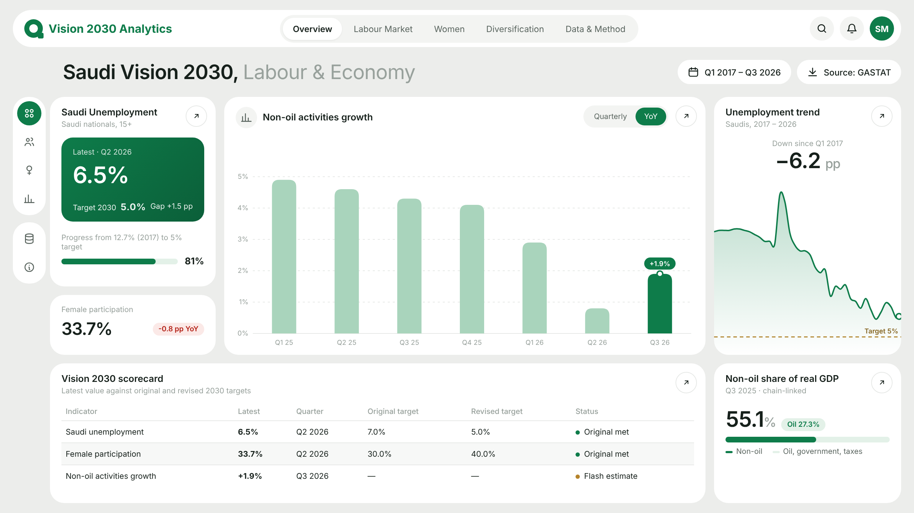
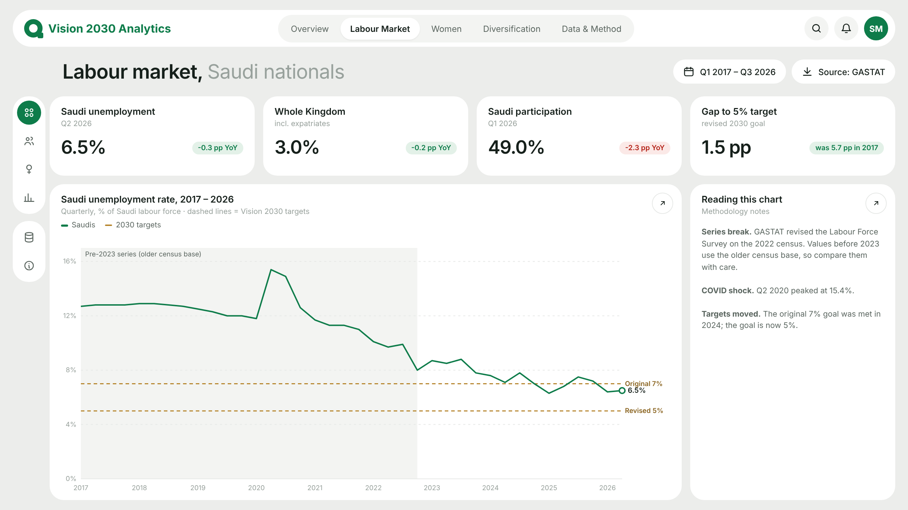
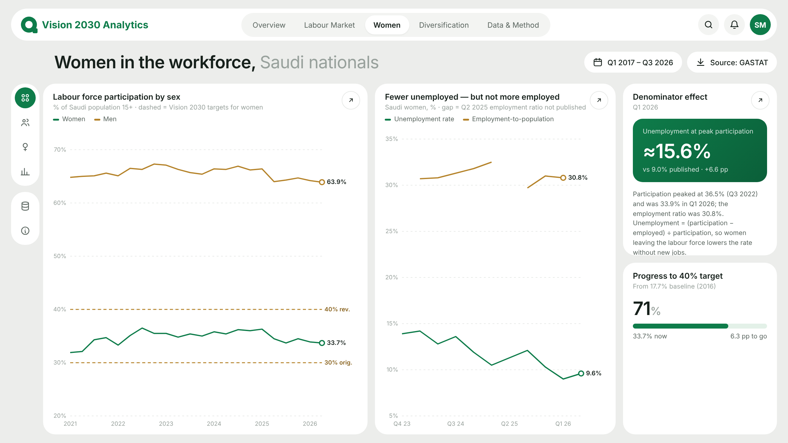
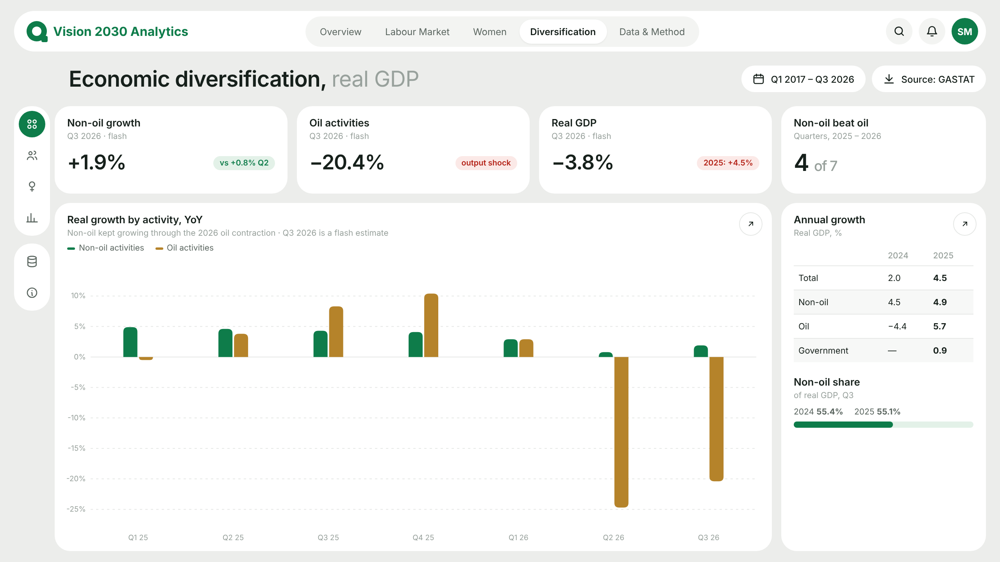
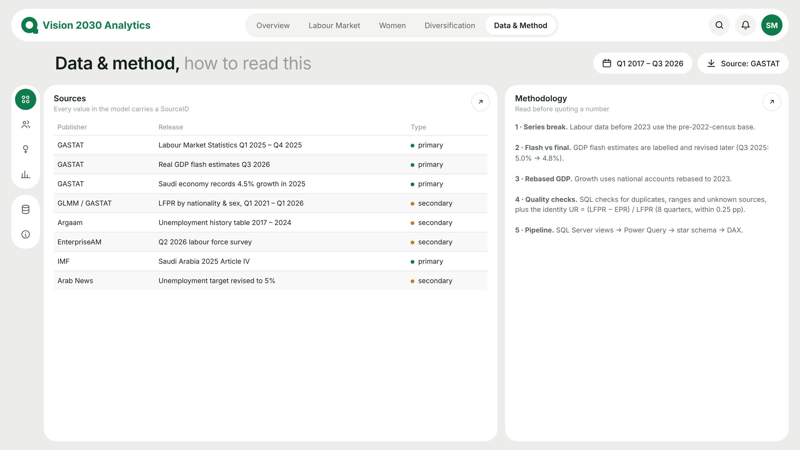

# Saudi Vision 2030 Analytics Dashboard

An interactive Power BI dashboard tracking three Vision 2030 headline areas — **Saudi unemployment, women's labour-force participation, and non-oil economic growth** — built on official GASTAT statistics, with a SQL Server data layer, Power Query transformations, a star-schema model and documented DAX.

> Personal portfolio project · Chloe (Noor) · Data: Q1 2017 – Q3 2026



<details>
<summary>Other pages: Labour Market · Women · Diversification · Data &amp; Method</summary>

| | |
|---|---|
|  |  |
|  |  |

</details>

<sub>Previews are rendered from the design mockup (`design/mockup.html`) that defines the report layout; the Power BI report in `powerbi/` implements the same five pages.</sub>

## Key findings (as of November 2026)

- **Unemployment target met early, then raised.** Saudi unemployment fell from 12.7% (Q1 2017) to 6.4–6.5% in H1 2026 — below the original 7% target, but not yet at the revised 5%.
- **Women's participation passed 30% and plateaued.** It peaked at 36.3% (Q1 2025) and was 33.7% in Q2 2026: above the original 30% target, 6+ points short of the revised 40%.
- **Lower female unemployment is partly a denominator effect.** Female unemployment fell to 9.0% (Q1 2026) while participation and the employment ratio also fell. At the series peak participation (36.5%, Q3 2022), the same employment ratio implies ≈15.6% unemployment.
- **Non-oil activity kept growing through the 2026 oil shock.** Oil activities fell >20% YoY in Q2–Q3 2026 and real GDP contracted; non-oil activities still grew (0.8%, then 1.9%). Non-oil activities are ≈55% of real GDP.

## Repository structure

```
data/raw/        curated source CSVs (reference copy of the SQL data)
sql/             01 tables · 02 data · 03 views · 04 quality checks (T-SQL)
powerquery/      M queries: SQL connection, types, quarter calendar, flags
design/          page mockups (preview/), page backgrounds, visual layout spec
powerbi/         Vision2030_Dashboard.pbip (Power BI project: report + semantic model), measures.dax, theme
scripts/         build_pbir_visuals.py: generates the report's visual JSON (PBIR) from the layout
docs/            build guide (Arabic)
```

## Architecture

```
SQL Server (Vision2030)
  stg.*  raw tables, one row per quarter, every row cites a SourceID
  dw.*   DimIndicator · DimTarget · DimSource
         vw_FactKPI            unpivot of all staging tables (CROSS APPLY VALUES)
         vw_GDPLevels          non-oil / oil share of real GDP
         vw_QA_FemaleIdentity  accounting-identity consistency check
        │
Power Query (M)
  parameters pServer / pDatabase · data types · DimQuarter generated in M
  IsFlash / IsPreRevision flags
        │
Power BI: star schema · ~40 DAX measures · 5 report pages
```

## Data model

| Table | Grain | Purpose |
|---|---|---|
| `FactKPI` | quarter × indicator | 198 values, 12 indicators, with vintage / estimate type / source |
| `DimQuarter` | quarter | continuous calendar 2017Q1–2026Q3, `QuarterIndex` for period offsets |
| `DimIndicator` | indicator | names (EN/AR), domain, unit, whether lower or higher is better |
| `DimTarget` | KPI | baseline, original and revised 2030 targets |
| `DimSource` | source | publisher, URL, primary vs secondary |

A long-format fact table lets one set of measures (`KPI Value`, `YoY Change pp`, `Progress to Revised Target %`) serve every indicator.

## Data quality and methodology

- **Series break:** GASTAT re-based the Labour Force Survey on the 2022 census. Values before 2023 are flagged `pre_census2022` and are not strictly comparable.
- **Flash vs final:** GDP flash estimates are labelled and replaced when final figures appear (e.g. Q3 2025: flash 5.0% → final 4.8%).
- **Rebased GDP:** GDP growth uses the rebased national accounts (base year 2023).
- **SQL quality checks (`sql/04`):** duplicates, quarter-key format, value ranges, unknown indicators, unknown sources (via `STRING_SPLIT`), and the identity `UR = (LFPR − EPR) / LFPR` for Saudi women (all 8 quarters within 0.25 pp).
- **Limitations:** some rows come from reputable secondary outlets quoting GASTAT; Saudi unemployment for Q2 2025 is derived from a published YoY change; non-oil GDP share is available for two quarters only.

## Reproduce

1. Install SQL Server 2022 Express and SSMS.
2. Run `sql/01` → `sql/04` in order (all re-runnable; checks 1–6 must return no rows).
3. In Power BI, create parameters `pServer` / `pDatabase` and paste the queries from `powerquery/queries.pq`.
4. Add the measures from `powerbi/measures.dax` and apply `powerbi/vision2030_theme.json`.

Step-by-step guide (Arabic): `docs/BUILD_GUIDE_AR.md`.

## Tools
SQL Server (T-SQL) · Power Query (M) · Power BI Desktop · DAX · Python (PBIR layout generation)

## Sources
Full list in `dw.DimSource` / `data/raw/sources.csv`. Main publisher: General Authority for Statistics (GASTAT), stats.gov.sa.
